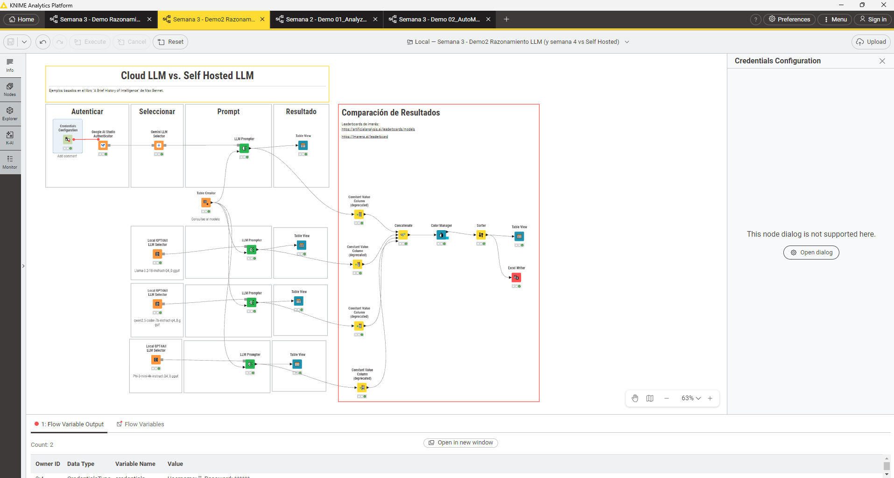

# Benchmark: Cloud LLM vs. Self-Hosted LLMs en KNIME

Este repositorio contiene un flujo de trabajo de **KNIME Analytics Platform** diseñado para evaluar y comparar de forma simultánea las capacidades de razonamiento, sentido común y resolución algebraica entre un modelo de frontera en la nube (**Google Gemini 2.5 Flash**) y modelos locales cuantizados (**GGUF**) ejecutados de forma autónoma mediante la integración de **GPT4All**.

Las pruebas de evaluación de razonamiento fueron adaptadas a partir de los conceptos analizados en el libro *"A Brief History of Intelligence"* de Max Bennett.

---

## 📸 Arquitectura del Flujo de Trabajo

El flujo está estructurado modularmente en cuatro fases:

1. **Autenticación y Credenciales:** Conexión segura a la API de Google AI Studio mediante variables de flujo.

2. **Selección de Modelos:** Enrutamiento simultáneo hacia Gemini Cloud y selectores locales de GPT4All.

3. **Inferencia en Lote (Prompting):** Distribución de un conjunto común de preguntas de prueba estructuradas en una tabla.

4. **Consolidación y Exportación:** Fusión de resultados (`Concatenate`), codificación cromática (`Color Manager`), ordenamiento y exportación tabular en formato Excel.

---

## 🤖 Modelos Evaluados

| Modelo | Tipo | Parámetros | Formato / Cuantización | Plataforma / Runtime |
| :--- | :--- | :--- | :--- | :--- |
| **Gemini 2.5 Flash** | Cloud API | No especificado | Propietario (Cloud) | Google AI Studio Connector |
| **Qwen 2.5 Coder** | Self-Hosted | 7B | `qwen2.5-coder-7b-instruct-q4_0.gguf` | Local GPT4All LLM Selector |
| **Phi-3 Mini 4K** | Self-Hosted | 3.8B | `Phi-3-mini-4k-instruct.Q4_0.gguf` | Local GPT4All LLM Selector |
| **Llama 3.2** | Self-Hosted | 1B | `Llama-3.2-1B-Instruct-Q4_0.gguf` | Local GPT4All LLM Selector |

---

## 🧪 Pruebas de Razonamiento y Resultados

Se evaluaron cuatro tipos de desafíos cognitivos para poner a prueba la frontera entre tamaño de parámetros, razonamiento simbólico y sentido común:

| Prompt de Prueba | Tipo de Reto | Gemini 2.5 Flash | Qwen 2.5 Coder 7B | Phi-3 Mini 4K | Llama 3.2 1B |
| :--- | :--- | :--- | :--- | :--- | :--- |
| *«Estoy en el sótano de mi casa, sin ventanas, miro hacia arriba y veo ____»* | Sentido Común / Entorno Físico | **Correcto**: Detalla vigas, tuberías, cables y aislamiento. | **Incierto**: Pide más contexto antes de arriesgar. | **Poético/Fantasioso**: "Luces suaves que parecen bailar". | **Alucinación**: "¿Es un árbol?". |
| *«Si a 5 cocineros les toma 5 minutos preparar 5 pizzas, ¿cuánto tiempo les tomaría a 100 cocineros preparar 100 pizzas?»* | Reflexión Cognitiva (CRT) / Paralelismo | **Correcto**: 5 minutos (con explicación paso a paso). | **Correcto**: 5 minutos. | **Impreciso**: "Un par de minutos" (identifica la lógica pero falla el cálculo). | **Erróneo**: Multiplicación ciega que da 2500. |
| *«Una pelota de fútbol y un par de canilleras cuestan 11 € en total. La pelota cuesta 10 € más que las canilleras. ¿Cuánto cuestan las canilleras?»* | Lógica Algebraica / Sesgo Intuitivo | **Correcto**: 0.50 € (demostración por sistema de ecuaciones). | **Correcto**: 0.50 € (con desglose algebraico formal). | **Sesgo Intuitivo**: 1 € (error clásico del problema bate-pelota). | **No responde**: Evasión / fallo en el seguimiento de instrucción. |
| *«si 3*x + 2 = 10, entonces x =»* | Resolución Simbólica de Ecuaciones | **Correcto**: `x = 8/3` (con desarrollo paso a paso). | **Correcto**: `x = 8/3` (notación matemática LaTeX). | **Correcto**: `x = 8/3` (directo y conciso). | **Erróneo**: `x = 4`. |

---

## ⚙️ Requisitos y Puesta en Marcha

### Prerrequisitos

1. **KNIME Analytics Platform** (versión 5.2 o superior).

2. **KNIME AI Extension** instalada (incluyendo las extensiones de *KNIME Generative AI* y soporte para *GPT4All*).

3. **API Key de Google AI Studio** (para el modelo cloud).

4. **GPT4All** instalado localmente o modelos descargados en formato `.gguf`.

### Instalación y Ejecución

1. Clona este repositorio o descarga el archivo `.knwf` desde la carpeta `/workflows`.

2. En KNIME, ve a `File` > `Import KNIME Workflow...` y selecciona `Cloud_LLM_vs_Self_Hosted_LLM.knwf`.

3. Descarga los modelos GGUF correspondientes a través de la interfaz de GPT4All o desde Hugging Face y colócalos en tu directorio local de modelos.

4. Abre la configuración de cada nodo **Local GPT4All LLM Selector**[cite: 1] y apunta a la ruta local de tus archivos `.gguf`.

5. Ejecuta el nodo **Credentials Configuration**[cite: 1] para ingresar tu API Key de Google AI Studio.

6. Ejecuta el flujo completo para regenerar las salidas y generar la tabla comparativa en Excel.

---

## 🔗 Referencias y Leaderboards de Interés

* Max Bennett: *A Brief History of Intelligence: Evolution, AI, and the Five Breakthroughs That Made Our Brains*.

* [Artificial Analysis AI Model Leaderboards](https://artificialanalysis.ai/leaderboards/models)

* [LMSYS Chatbot Arena Leaderboard](https://lmarena.ai/leaderboard)

